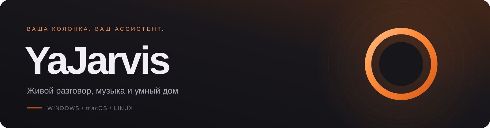

<p align="center">
  
</p>

<h1 align="center">Jarvis для Яндекс Станции Лайт 2</h1>

<p align="center">
  Независимая кастомная прошивка на Rust (<code>jarvisd</code>) и веб-панель <strong>«Камин и Стекло»</strong> на SvelteKit<br>
  с быстрым голосовым пайплайном, гибридной музыкой, студией режимов и собственными OTA-релизами.
</p>

<p align="center">
  <a href="https://github.com/Georgvadis/Jarvis/releases/latest"></a>
  <a href="https://github.com/Georgvadis/Jarvis/actions/workflows/release.yml"></a>
  <a href="LICENSE"></a>
</p>

<p align="center">
  <a href="https://github.com/Georgvadis/Jarvis/releases/latest"><strong>Релизы</strong></a> ·
  <a href="#возможности"><strong>Возможности</strong></a> ·
  <a href="#структура-репозитория"><strong>Архитектура</strong></a> ·
  <a href="#сборка-и-ota-обновления"><strong>Сборка и OTA</strong></a> ·
  <a href="#документация"><strong>Документация</strong></a>
</p>

---

## О проекте

Этот репозиторий — самостоятельная кастомная ветка развития прошивки **Jarvis** (`Georgvadis/Jarvis`) под **Яндекс Станцию Лайт 2 (`arm64`)**: ядро `jarvisd` и супервайзер `jarvis-supervisor` на Rust работают рядом со штатной Алисой, не мешая ей и не привязываясь к сторонним обновлениям.

Актуальный релиз — **[v1.0.0](docs/releases/1.0.0.md)** (`Georgvadis/Jarvis`).

---

## Возможности

### 1. Голосовой пайплайн и быстрый отклик
- **Локальная активация и чистый хэндофф (`engine.rs`, `wake_reply.rs`)**: детектор `openWakeWord`, передача только последних `200 мс` preroll для режима `Classic`, мгновенный звуковой отклик (`wake_ack_chime`) и фоновый автопрогрев локального кэша `wake-replies` после старта.
- **Тихая речь с расстояния и склейка пауз (`classic_voice.rs`, `settings.rs`)**: чувствительные пороги VAD (`vad_threshold: 380`, `vad_silence_ms: 850`), адаптивный `Capture` с предзаписью (`9600` сэмплов), сохранение первой половины фраз при разбиении паузами (`active_turn_pcm` / `pending_user_text`) и ожидание вводных слов, фильтрация голого слова активации без обращения к LLM.
- **Минимальная задержка STT → LLM → TTS**:
  - прямой HTTP-вызов локального `/stt` из Rust (без Lua/Base64) с резервным фолбэком;
  - выборочное подключение `web_search` / `googleSearch` (`should_use_web_search`) только там, где реально нужны свежие факты из сети;
  - фоновый прогрев токена и HTTP/2-соединения (`codex.warm`) для `Classic` ChatGPT, параллельный запуск `tools.prepare()` и `auth.token`;
  - раннее расщепление первой фразы (`pop_ready_sentence`), потоковый HTTP/2-синтез `fish-audio-tts` прямо в PCM и поддержка эмоций/звуковых эффектов (`[happy]`, `[whisper]`, `[sfx:...]`, многоголосие).
- **Быстрые локальные команды и профили (`tools.rs`, `fastcmd.rs`, `session.rs`)**: мгновенные ответы без облака (время, дата, громкость, звуки сна, текущая погода) и голосовое переключение профилей ассистента («переключи профиль на Рюка», «включи ассистента Аянами») с русскими падежами, мгновенным обновлением LED-подсветки и мягким завершением диалога после подтверждения.

### 2. Веб-панель «Камин и Стекло» (`/`) и Студия (`/studio`)
- **Интерфейс Fireside Glass (`jarvisd/ui`)**: тёмная и светлая темы, 5 акцентов, PWA (`/sw.js`, оффлайн-экран ожидания перезагрузки), **Чат 2.0** с рендерингом Markdown, палитра команд `Ctrl+K` и мобильная навигация.
- **Центр здоровья и мониторинг (`/charts`)**: живая телеметрия колонки и параллельная проверка компонентов стека (`GET /api/stack-health`).
- **Студия (`/studio`)**:
  - **Локальный NotebookLM и споры** — генерация двуголосых подкастов из YouTube, статей, PDF/EPUB/FB2/TXT или текста;
  - **Читалка книг и ранобэ** — загрузка книг, закладки, главы, многоголосие и голосовой пересказ «на чём остановились»;
  - **Голосовые игры** — «Угадай мелодию / Аниме-опенинг» (с отсчётом на LED-дисплее), «Нуарный детектив», «Ведущий Мафии / Бункера»;
  - **Персональный AI-DJ** — тематические волны YouTube Music с радио-подводками;
  - **Заметки (`CyberNotes`) и чеклисты** — голосовые заметки, списки покупок и дел (`lists.json`);
  - **Расписание и таймеры** — обратные таймеры на LED-экране и постоянные рутины по дням недели (`schedules.json`).

### 3. Музыка, умный дом и интеграции
- **Гибридная музыка без конфликтов (`music.rs`, `alice_music.rs`)**: YouTube Music (`play_music`, поиск официальных треков без миксов, очередь и лайки голосом) работает сервисом по умолчанию; Яндекс Музыка запускается тихо без голоса Алисы через `play_yandex_music` (по явному запросу «в Яндекс Музыке» / «Мою волну» или в резерве); усиленный и быстрый дакинг громкости на время речи.
- **Фоновые звуки и радио (`ambient.rs`)**: офлайн-пресеты («Океан», «Дождь», «Камин», «Лес», белый шум) и пользовательские интернет-радиостанции с плавным приглушением.
- **Жесты и LED (`buttons.rs`, `led.rs`)**: комбинация `+ − + − + − + −` сбрасывает пароль панели, а быстрый жест `− + + −` мгновенно останавливает все активности или запускает прослушивание.
- **Умный дом и внешние агенты**: Home Assistant, Xiaomi Home, Smart Life (Tuya), Яндекс Умный дом, двусторонний **Telegram-бот** (`/ask`, `/timer`, `/scenario`, `/pc`, `/book`, `/podcast`, `/dj`), определение присутствия в домашнем Wi-Fi (`presence.rs`), интеграция с ПК-компаньоном (`look_at_screen`, `pc_control`), постоянная память диалога (`chatgpt-chat-archive.jsonl`) и песочница плагинов **Lua 5.4 / Rust SDK**.

---

## Структура репозитория

| Путь | Назначение |
| :--- | :--- |
| [`jarvis/core/`](jarvis/core) | Основной демон `jarvisd`: аудио-пайплайн, VAD, LLM/TTS, инструменты, Telegram-бот, веб-сервер |
| [`jarvis/modules/`](jarvis/modules) | Встроенные Rust-модули (`chatgpt`, `cloud`, `homeassistant`, `smartlife`, `xiaomi`, `yandexhome`, `youtube`, `vpn`, `wake-train`) |
| [`jarvis/station-runtime/`](jarvis/station-runtime) | `jarvis-supervisor` — безопасная выкатка обновлений, проверка целостности и автооткат |
| [`jarvis/official-plugin/`](jarvis/official-plugin) | Сборка официальных Rust-плагинов под `arm64` / `armv7` |
| [`jarvisd/ui/`](jarvisd/ui) | Веб-панель SvelteKit («Камин и Стекло») |
| [`plugins/`](plugins) | Каталог и манифесты плагинов (`plugins/index.json`) + Lua-плагины |
| [`station/`](station) | Скрипты запуска (`jarvisd.sh`, `S98jarvisd`) и нативные C-хуки (`vqe_tap.c`, `spotcmd.c`) |
| [`docs/`](docs) | Документация, заметки к релизам (`docs/releases/`) и спецификации SDK |

---

## Сборка и OTA-обновления

### Локальная сборка под `arm64`
```sh
VERSION=1.0.0 REPO=Georgvadis/Jarvis STATION_ARCHES=arm64 sh build.sh
```
Артефакты собираются в `build/release/`: `jarvisd-arm64`, `station-arm64.zip`, пакеты официальных плагинов `plugin-*.zip`, `rust-builds.json` и `SHA256SUMS`. Подробности окружения — в [docs/BUILD.md](docs/BUILD.md).

### OTA из `Georgvadis/Jarvis`
- В ядре по умолчанию прописан репозиторий **`Georgvadis/Jarvis`** (`DEFAULT_REPO`), проверка обновлений включена, а ночная автоматическая перезапись прошивки (`update_auto`) и телеметрия (`no_stats`) **выключены**.
- Проверить и установить обновление можно вручную в панели (**Безопасность → Обновления**) либо загрузкой файла `jarvisd-arm64` с ПК. Перед запуском `jarvis-supervisor` проверяет **SHA-256** и при сбое откатывает предыдущий рабочий бинарник.
- Публикация нового релиза в GitHub автоматизирована через [`.github/workflows/release.yml`](.github/workflows/release.yml): достаточно создать заметки в `docs/releases/<версия>.md` и запушить тег `v<версия>`.
- **Сброс пароля панели**: нажмите на колонке кнопки громкости `+ − + − + − + −` (8 раз подряд с паузой не дольше 1,5 с).

---

## Документация

- [Сборка из исходников](docs/BUILD.md)
- [Вики по плагинам](docs/PLUGINS.md) · [Гайд для AI-агентов (`PLUGIN-AGENT.md`)](docs/PLUGIN-AGENT.md)
- [Справочник Lua API](docs/LUA.md) · [Нативные Rust-плагины](docs/NATIVE-PLUGINS.md) · [Встроенные модули](docs/RUST-MODULES.md)
- [Дообучение слова активации](docs/WAKEWORD.md) · [Приватность и данные](docs/PRIVACY.md)

---

## Основа и лицензия

Проект распространяется по лицензии **[MIT License](LICENSE)** и основан на открытом коде оригинального **[YaJarvis](https://github.com/newfpv/YaJarvis)**. Благодарности авторам и сторонним библиотекам сохранены в [CREDITS.md](CREDITS.md), [THIRD_PARTY.md](THIRD_PARTY.md) и [LICENSES](LICENSES).
